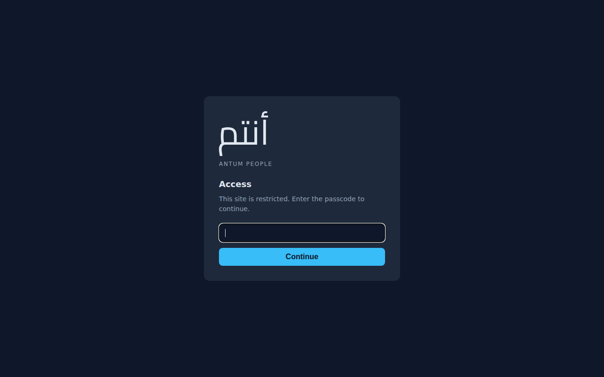

# The passcode wall carries the wordmark أنتم — 2026-11-10

Owner decision (brief: `/home/team/shared/gate-wordmark-brief.md`): the gate page must carry the
Arabic wordmark **أنتم**. Branch `feat/gate-wordmark-antum`, cut from `origin/main` `8f74177`.
No merge, no deploy, no restart was performed for this change.

## The route: vector paths, not text and not a webfont

The mark is committed in `server/public-gate.js` as path data (`WORDMARK_PATH`, viewBox
`0 0 1413 1295`), cut from **Cairo** — the brand face, OFL, already in the repository at
`client/public/fonts/cairo/cairo-arabic.woff2` — shaped with **HarfBuzz** so أنتم comes out in its
connected forms, and outlined with **fontTools** (glyphs placed by their HarfBuzz advances, y flipped
for SVG, ink box translated to the origin; integer font units, 1/1000 em).

Why this route, and not the two alternatives:

- **Text with a fallback** would depend on an Arabic-capable font being installed on the visitor's
  machine. Where none is, the mark is empty boxes — worse than a wall that names nobody, which is the
  brief's own test. It would also draw the mark in whichever face the visitor happens to have, not in
  the brand's.
- **A webfont** would need a second request, and this gate answers *every* path without a cookie with
  the gate page — the font request would come back as HTML. It would also dwarf the page.
- **Paths** are font-free at run time: no request, no fallback, no font installed, identical pixels
  everywhere. The mark is checked against the browser's own Cairo rendering of the same string before
  it was committed: the cut paths and `أنتم` render the same
  shape (side-by-side comparison, not committed — it embeds the woff2, which the gate would never
  serve).

## Measured, before → after

| | before (`8f74177`) | after (this branch) |
|---|---|---|
| gate page bytes | **1,628 B** | **3,308 B** |
| `<title>` | `Antum People — access` | `Antum People — access` (unchanged) |
| `<svg>` on the page | 0 | 1 (path, 1,694 chars of `d`) |
| font references (`@font-face`, `.woff`) | 0 | 0 |

The old byte figure **1,628 B is withdrawn**: it described the page at `8f74177`, which carried no
wordmark. Every future byte count of this page names the tree it was measured in.

## Proof on a rendered screen

- **Rig:** a scratch instance (`/tmp/wm/rig.js`, port 4599, throwaway passcode hash and signing key)
  mounting **this branch's own** `server/public-gate.js` in front of a stand-in product tree. Not the
  live product; nothing on the host was touched.
- **Page identity, taken with the shot:** the served gate page is **3,308 B**, md5
  `f7090503b90d1f193a5dd3b898e81b55` — byte-identical to `gatePage()` from this branch's module
  (`md5sum` of both, compared).
- **Viewport:** 1280x800, browser default (no device emulation).
- **Brand fonts absent:** on the machine that took the shot, `fc-list | grep -ci cairo` = 0,
  `noto naskh` = 0, `noto kufi` = 0. The page requests no font at all (`document.fonts.size` is the
  default set), so the mark is drawn from the path data alone.

## The wall is still a wall

Measured on the same rig, same bytes:

- **No cookie:** `GET /` → **200**, `<title>Antum People — access</title>`, **3,308 B**, `#root` ×0,
  no `assets/index-*` named, no `/api` hint, `Cache-Control: no-store`.
- **With a cookie** (minted from the rig's throwaway signing key): `GET /` → **200**,
  `<title>Antum People</title>`, `#root` ×1, names `assets/index-TESTRIG.js` — the product shell.
- The honesty is unchanged: "Access" and "This site is restricted. Enter the passcode to continue."
  are still on the page, above the one input and one submit.

## The instrument moved with the page

`server/public-gate.test.js`, first cookieless test, now asserts (and pins):

- the page carries `<svg class="mark" viewBox="0 0 1413 1295" role="img" aria-label="…أنتم…">`;
- the mark is a `<path … d="M…Z"/>`, not text;
- the page loads **no** font (`@font-face` / `.woff` absent);
- the page's byte count is **exactly 3,308** — a change to the wall has to move this number on purpose.

Nothing was loosened: the title assertion, the one-input/one-submit counts, `assertNothingOfTheProduct`
and the `no-store` assertion are untouched. The title is unchanged, so the rows in
`scripts/deploy-main-gate-test.sh`, `scripts/gate-rotate-test.sh` and `server/public-gate.test.js`
that pin `<title>Antum People — access</title>` still hold as written.

Run: `cd server && node --test public-gate.test.js` → **15 tests, 15 pass, 0 fail, 0 skipped**.
